# Отчёт о производительности моделей YOLO на Orange Pi 5 Pro

- Дата генерации: 2026-09-26 15:47:40
- Моделей в results.json: 111
- Железо: Orange Pi 5 Pro, RK3588 (8 ядер, NPU)
- Ось X — время обработки одного кадра (мс = 1000/fps), ось Y — основная метрика
- Линиями соединены модели одного семейства; цвет поколения одинаков на ВСЕХ графиках
- В легенде каждая линия — отдельная запись вида «семейство (вариант)»
- цвет поколения одинаков на всех графиках.

## Детекция (detect)

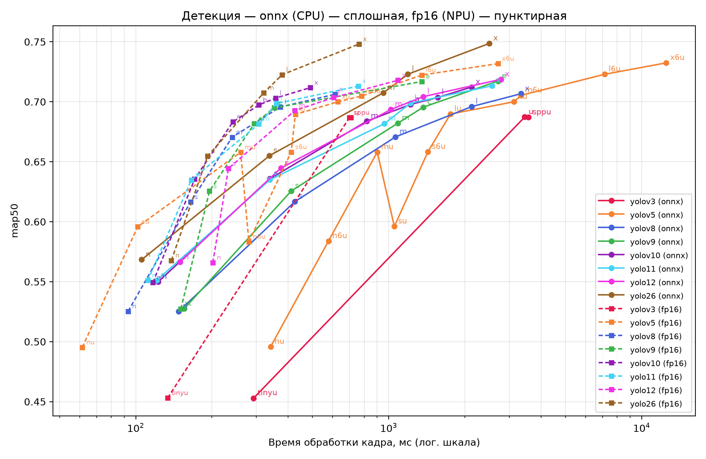

### onnx (CPU) — сплошная, fp16 (NPU) — пунктирная

| Модель | Семейство | Размер | onnx (CPU): мс | onnx (CPU): fps | onnx (CPU): метрика | fp16 (NPU): мс | fp16 (NPU): fps | fp16 (NPU): метрика |
|---|---|---|---|---|---|---|---|---|
| yolo11l | yolo11 | l | 1219.5 | 0.8 | 0.6989 | 359.7 | 2.8 | 0.6985 |
| yolo11m | yolo11 | m | 961.5 | 1.0 | 0.6818 | 306.7 | 3.3 | 0.6816 |
| yolo11n | yolo11 | n | 120.9 | 8.3 | 0.5512 | 111.6 | 9.0 | 0.5510 |
| yolo11s | yolo11 | s | 339.0 | 3.0 | 0.6349 | 165.8 | 6.0 | 0.6348 |
| yolo11x | yolo11 | x | 2564.1 | 0.4 | 0.7133 | 757.6 | 1.3 | 0.7130 |
| yolo12l | yolo12 | l | 1369.9 | 0.7 | 0.7043 | 606.1 | 1.6 | 0.7036 |
| yolo12m | yolo12 | m | 1020.4 | 1.0 | 0.6936 | 425.5 | 2.4 | 0.6927 |
| yolo12n | yolo12 | n | 149.7 | 6.7 | 0.5664 | 201.6 | 5.0 | 0.5659 |
| yolo12s | yolo12 | s | 374.5 | 2.7 | 0.6447 | 232.6 | 4.3 | 0.6444 |
| yolo12x | yolo12 | x | 2777.8 | 0.4 | 0.7187 | 1087.0 | 0.9 | 0.7179 |
| yolo26l | yolo26 | l | 1190.5 | 0.8 | 0.7230 | 378.8 | 2.6 | 0.7225 |
| yolo26m | yolo26 | m | 952.4 | 1.1 | 0.7075 | 320.5 | 3.1 | 0.7074 |
| yolo26n | yolo26 | n | 105.6 | 9.5 | 0.5684 | 138.3 | 7.2 | 0.5677 |
| yolo26s | yolo26 | s | 337.8 | 3.0 | 0.6551 | 192.3 | 5.2 | 0.6547 |
| yolo26x | yolo26 | x | 2500.0 | 0.4 | 0.7487 | 763.4 | 1.3 | 0.7481 |
| yolov10b | yolov10 | b | 1219.5 | 0.8 | 0.6978 | 306.7 | 3.3 | 0.6973 |
| yolov10l | yolov10 | l | 1562.5 | 0.6 | 0.7036 | 357.1 | 2.8 | 0.7031 |
| yolov10m | yolov10 | m | 819.7 | 1.2 | 0.6839 | 242.1 | 4.1 | 0.6832 |
| yolov10n | yolov10 | n | 122.5 | 8.2 | 0.5499 | 116.8 | 8.6 | 0.5493 |
| yolov10s | yolov10 | s | 339.0 | 3.0 | 0.6358 | 170.9 | 5.8 | 0.6355 |
| yolov10x | yolov10 | x | 2127.7 | 0.5 | 0.7123 | 490.2 | 2.0 | 0.7118 |
| yolov3-sppu | yolov3 | sppu | 3571.4 | 0.3 | 0.6870 | 699.3 | 1.4 | 0.6868 |
| yolov3-tinyu | yolov3 | tinyu | 292.4 | 3.4 | 0.4529 | 133.7 | 7.5 | 0.4531 |
| yolov3u | yolov3 | u | 3448.3 | 0.3 | 0.6873 | 709.2 | 1.4 | 0.6868 |
| yolov5l6u | yolov5 | l6u | 7142.9 | 0.1 | 0.7229 | 1351.4 | 0.7 | 0.7223 |
| yolov5lu | yolov5 | lu | 1754.4 | 0.6 | 0.6898 | 427.4 | 2.3 | 0.6894 |
| yolov5m6u | yolov5 | m6u | 3333.3 | 0.3 | 0.7054 | 781.2 | 1.3 | 0.7048 |
| yolov5mu | yolov5 | mu | 900.9 | 1.1 | 0.6581 | 259.7 | 3.9 | 0.6580 |
| yolov5n6u | yolov5 | n6u | 578.0 | 1.7 | 0.5839 | 280.1 | 3.6 | 0.5833 |
| yolov5nu | yolov5 | nu | 341.3 | 2.9 | 0.4958 | 61.5 | 16.3 | 0.4953 |
| yolov5s6u | yolov5 | s6u | 1428.6 | 0.7 | 0.6583 | 411.5 | 2.4 | 0.6581 |
| yolov5su | yolov5 | su | 1052.6 | 0.9 | 0.5961 | 101.8 | 9.8 | 0.5959 |
| yolov5x6u | yolov5 | x6u | 12500.0 | 0.1 | 0.7324 | 2702.7 | 0.4 | 0.7318 |
| yolov5xu | yolov5 | xu | 3125.0 | 0.3 | 0.7000 | 628.9 | 1.6 | 0.7000 |
| yolov8l | yolov8 | l | 2127.7 | 0.5 | 0.6960 | 373.1 | 2.7 | 0.6957 |
| yolov8m | yolov8 | m | 1063.8 | 0.9 | 0.6707 | 240.4 | 4.2 | 0.6704 |
| yolov8n | yolov8 | n | 147.9 | 6.8 | 0.5254 | 93.3 | 10.7 | 0.5254 |
| yolov8s | yolov8 | s | 425.5 | 2.4 | 0.6167 | 164.7 | 6.1 | 0.6165 |
| yolov8x | yolov8 | x | 3333.3 | 0.3 | 0.7067 | 613.5 | 1.6 | 0.7062 |
| yolov9c | yolov9 | c | 1369.9 | 0.7 | 0.6955 | 353.4 | 2.8 | 0.6950 |
| yolov9e | yolov9 | e | 2702.7 | 0.4 | 0.7173 | 1351.4 | 0.7 | 0.7169 |
| yolov9m | yolov9 | m | 1087.0 | 0.9 | 0.6822 | 294.1 | 3.4 | 0.6817 |
| yolov9s | yolov9 | s | 411.5 | 2.4 | 0.6256 | 195.7 | 5.1 | 0.6255 |
| yolov9t | yolov9 | t | 155.8 | 6.4 | 0.5277 | 150.8 | 6.6 | 0.5273 |

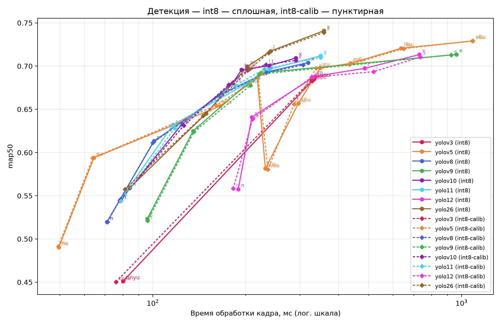

### int8 — сплошная, int8-calib — пунктирная

| Модель | Семейство | Размер | int8 (NPU): мс | int8 (NPU): fps | int8 (NPU): метрика | int8-calib (NPU): мс | int8-calib (NPU): fps | int8-calib (NPU): метрика |
|---|---|---|---|---|---|---|---|---|
| yolo11l | yolo11 | l | 238.1 | 4.2 | 0.6963 | 229.4 | 4.4 | 0.6964 |
| yolo11m | yolo11 | m | 198.0 | 5.0 | 0.6785 | 185.5 | 5.4 | 0.6777 |
| yolo11n | yolo11 | n | 79.0 | 12.7 | 0.5467 | 78.7 | 12.7 | 0.5438 |
| yolo11s | yolo11 | s | 116.0 | 8.6 | 0.6317 | 117.8 | 8.5 | 0.6282 |
| yolo11x | yolo11 | x | 349.7 | 2.9 | 0.7119 | 349.7 | 2.9 | 0.7101 |
| yolo12l | yolo12 | l | 485.4 | 2.1 | 0.6974 | 518.1 | 1.9 | 0.6935 |
| yolo12m | yolo12 | m | 334.4 | 3.0 | 0.6881 | 326.8 | 3.1 | 0.6870 |
| yolo12n | yolo12 | n | 189.0 | 5.3 | 0.5575 | 182.1 | 5.5 | 0.5583 |
| yolo12s | yolo12 | s | 209.2 | 4.8 | 0.6409 | 210.5 | 4.8 | 0.6388 |
| yolo12x | yolo12 | x | 729.9 | 1.4 | 0.7133 | 735.3 | 1.4 | 0.7105 |
| yolo26l | yolo26 | l | 240.4 | 4.2 | 0.7173 | 237.0 | 4.2 | 0.7153 |
| yolo26m | yolo26 | m | 202.4 | 4.9 | 0.6995 | 205.3 | 4.9 | 0.6964 |
| yolo26n | yolo26 | n | 84.1 | 11.9 | 0.5590 | 81.2 | 12.3 | 0.5576 |
| yolo26s | yolo26 | s | 148.8 | 6.7 | 0.6452 | 145.6 | 6.9 | 0.6425 |
| yolo26x | yolo26 | x | 358.4 | 2.8 | 0.7409 | 358.4 | 2.8 | 0.7389 |
| yolov10b | yolov10 | b | 193.8 | 5.2 | 0.6958 | 202.4 | 4.9 | 0.6951 |
| yolov10l | yolov10 | l | 237.5 | 4.2 | 0.7003 | 232.6 | 4.3 | 0.7016 |
| yolov10m | yolov10 | m | 181.2 | 5.5 | 0.6801 | 176.1 | 5.7 | 0.6785 |
| yolov10n | yolov10 | n | 78.2 | 12.8 | 0.5441 | 78.6 | 12.7 | 0.5455 |
| yolov10s | yolov10 | s | 124.2 | 8.1 | 0.6328 | 126.1 | 7.9 | 0.6313 |
| yolov10x | yolov10 | x | 290.7 | 3.4 | 0.7094 | 290.7 | 3.4 | 0.7064 |
| yolov3-sppu | yolov3 | sppu | 333.3 | 3.0 | 0.6853 | 327.9 | 3.0 | 0.6827 |
| yolov3-tinyu | yolov3 | tinyu | 80.0 | 12.5 | 0.4510 | 75.9 | 13.2 | 0.4503 |
| yolov3u | yolov3 | u | 330.0 | 3.0 | 0.6838 | 326.8 | 3.1 | 0.6841 |
| yolov5l6u | yolov5 | l6u | 636.9 | 1.6 | 0.7206 | 649.4 | 1.5 | 0.7202 |
| yolov5lu | yolov5 | lu | 217.9 | 4.6 | 0.6868 | 219.3 | 4.6 | 0.6863 |
| yolov5m6u | yolov5 | m6u | 436.7 | 2.3 | 0.7032 | 432.9 | 2.3 | 0.7018 |
| yolov5mu | yolov5 | mu | 165.3 | 6.0 | 0.6539 | 160.3 | 6.2 | 0.6544 |
| yolov5n6u | yolov5 | n6u | 231.5 | 4.3 | 0.5814 | 235.8 | 4.2 | 0.5803 |
| yolov5nu | yolov5 | nu | 49.6 | 20.2 | 0.4903 | 49.4 | 20.2 | 0.4914 |
| yolov5s6u | yolov5 | s6u | 295.9 | 3.4 | 0.6567 | 286.5 | 3.5 | 0.6557 |
| yolov5su | yolov5 | su | 64.4 | 15.5 | 0.5940 | 63.9 | 15.7 | 0.5938 |
| yolov5x6u | yolov5 | x6u | 1087.0 | 0.9 | 0.7291 | 1087.0 | 0.9 | 0.7293 |
| yolov5xu | yolov5 | xu | 348.4 | 2.9 | 0.6978 | 337.8 | 3.0 | 0.6976 |
| yolov8l | yolov8 | l | 236.4 | 4.2 | 0.6936 | 232.6 | 4.3 | 0.6922 |
| yolov8m | yolov8 | m | 166.7 | 6.0 | 0.6676 | 165.3 | 6.0 | 0.6660 |
| yolov8n | yolov8 | n | 71.0 | 14.1 | 0.5196 | 71.3 | 14.0 | 0.5198 |
| yolov8s | yolov8 | s | 100.9 | 9.9 | 0.6132 | 99.9 | 10.0 | 0.6113 |
| yolov8x | yolov8 | x | 318.5 | 3.1 | 0.7040 | 306.7 | 3.3 | 0.7013 |
| yolov9c | yolov9 | c | 224.2 | 4.5 | 0.6923 | 221.2 | 4.5 | 0.6906 |
| yolov9e | yolov9 | e | 961.5 | 1.0 | 0.7135 | 925.9 | 1.1 | 0.7129 |
| yolov9m | yolov9 | m | 200.0 | 5.0 | 0.6782 | 207.0 | 4.8 | 0.6776 |
| yolov9s | yolov9 | s | 135.0 | 7.4 | 0.6249 | 135.9 | 7.4 | 0.6240 |
| yolov9t | yolov9 | t | 95.9 | 10.4 | 0.5233 | 96.2 | 10.4 | 0.5211 |

## Сегментация (seg)

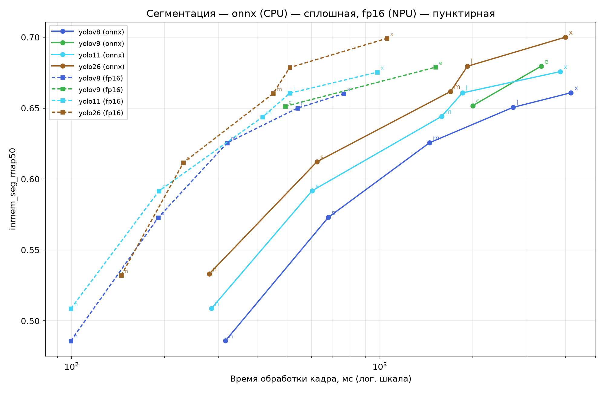

### onnx (CPU) — сплошная, fp16 (NPU) — пунктирная

| Модель | Семейство | Размер | onnx (CPU): мс | onnx (CPU): fps | onnx (CPU): метрика | fp16 (NPU): мс | fp16 (NPU): fps | fp16 (NPU): метрика |
|---|---|---|---|---|---|---|---|---|
| yolo11l-seg | yolo11 | l | 1851.9 | 0.5 | 0.6607 | 510.2 | 2.0 | 0.6605 |
| yolo11m-seg | yolo11 | m | 1587.3 | 0.6 | 0.6442 | 416.7 | 2.4 | 0.6438 |
| yolo11n-seg | yolo11 | n | 284.1 | 3.5 | 0.5088 | 99.4 | 10.1 | 0.5087 |
| yolo11s-seg | yolo11 | s | 602.4 | 1.7 | 0.5917 | 191.9 | 5.2 | 0.5916 |
| yolo11x-seg | yolo11 | x | 3846.2 | 0.3 | 0.6757 | 980.4 | 1.0 | 0.6753 |
| yolo26l-seg | yolo26 | l | 1923.1 | 0.5 | 0.6795 | 510.2 | 2.0 | 0.6786 |
| yolo26m-seg | yolo26 | m | 1694.9 | 0.6 | 0.6617 | 450.5 | 2.2 | 0.6603 |
| yolo26n-seg | yolo26 | n | 279.3 | 3.6 | 0.5331 | 144.7 | 6.9 | 0.5320 |
| yolo26s-seg | yolo26 | s | 625.0 | 1.6 | 0.6122 | 230.4 | 4.3 | 0.6116 |
| yolo26x-seg | yolo26 | x | 4000.0 | 0.2 | 0.7000 | 1052.6 | 0.9 | 0.6991 |
| yolov8l-seg | yolov8 | l | 2702.7 | 0.4 | 0.6505 | 540.5 | 1.9 | 0.6500 |
| yolov8m-seg | yolov8 | m | 1449.3 | 0.7 | 0.6256 | 319.5 | 3.1 | 0.6255 |
| yolov8n-seg | yolov8 | n | 315.5 | 3.2 | 0.4860 | 99.3 | 10.1 | 0.4859 |
| yolov8s-seg | yolov8 | s | 680.3 | 1.5 | 0.5730 | 190.8 | 5.2 | 0.5728 |
| yolov8x-seg | yolov8 | x | 4166.7 | 0.2 | 0.6608 | 763.4 | 1.3 | 0.6602 |
| yolov9c-seg | yolov9 | c | 2000.0 | 0.5 | 0.6517 | 492.6 | 2.0 | 0.6512 |
| yolov9e-seg | yolov9 | e | 3333.3 | 0.3 | 0.6795 | 1515.2 | 0.7 | 0.6788 |

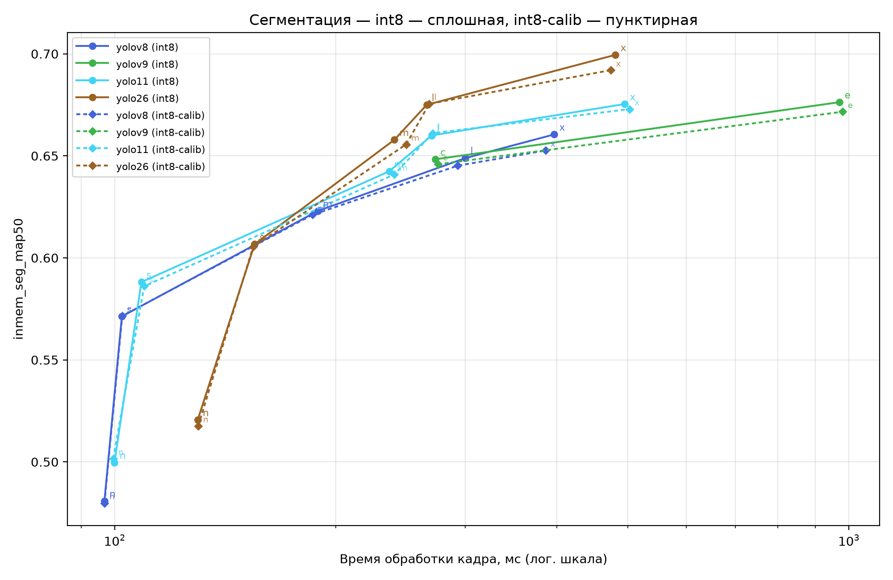

### int8 — сплошная, int8-calib — пунктирная

| Модель | Семейство | Размер | int8 (NPU): мс | int8 (NPU): fps | int8 (NPU): метрика | int8-calib (NPU): мс | int8-calib (NPU): fps | int8-calib (NPU): метрика |
|---|---|---|---|---|---|---|---|---|
| yolo11l-seg | yolo11 | l | 270.3 | 3.7 | 0.6600 | 271.0 | 3.7 | 0.6611 |
| yolo11m-seg | yolo11 | m | 236.4 | 4.2 | 0.6424 | 240.4 | 4.2 | 0.6409 |
| yolo11n-seg | yolo11 | n | 99.9 | 10.0 | 0.4997 | 99.5 | 10.1 | 0.5016 |
| yolo11s-seg | yolo11 | s | 108.7 | 9.2 | 0.5881 | 109.6 | 9.1 | 0.5861 |
| yolo11x-seg | yolo11 | x | 495.0 | 2.0 | 0.6754 | 502.5 | 2.0 | 0.6729 |
| yolo26l-seg | yolo26 | l | 266.0 | 3.8 | 0.6750 | 268.1 | 3.7 | 0.6755 |
| yolo26m-seg | yolo26 | m | 240.4 | 4.2 | 0.6579 | 249.4 | 4.0 | 0.6556 |
| yolo26n-seg | yolo26 | n | 129.7 | 7.7 | 0.5206 | 129.9 | 7.7 | 0.5176 |
| yolo26s-seg | yolo26 | s | 155.0 | 6.5 | 0.6067 | 154.3 | 6.5 | 0.6054 |
| yolo26x-seg | yolo26 | x | 480.8 | 2.1 | 0.6995 | 473.9 | 2.1 | 0.6920 |
| yolov8l-seg | yolov8 | l | 300.3 | 3.3 | 0.6489 | 293.3 | 3.4 | 0.6452 |
| yolov8m-seg | yolov8 | m | 189.0 | 5.3 | 0.6230 | 185.9 | 5.4 | 0.6211 |
| yolov8n-seg | yolov8 | n | 96.8 | 10.3 | 0.4808 | 96.8 | 10.3 | 0.4798 |
| yolov8s-seg | yolov8 | s | 102.2 | 9.8 | 0.5713 | 102.4 | 9.8 | 0.5715 |
| yolov8x-seg | yolov8 | x | 396.8 | 2.5 | 0.6605 | 386.1 | 2.6 | 0.6526 |
| yolov9c-seg | yolov9 | c | 273.2 | 3.7 | 0.6483 | 275.5 | 3.6 | 0.6459 |
| yolov9e-seg | yolov9 | e | 970.9 | 1.0 | 0.6763 | 980.4 | 1.0 | 0.6716 |

## Ключевые точки (pose)

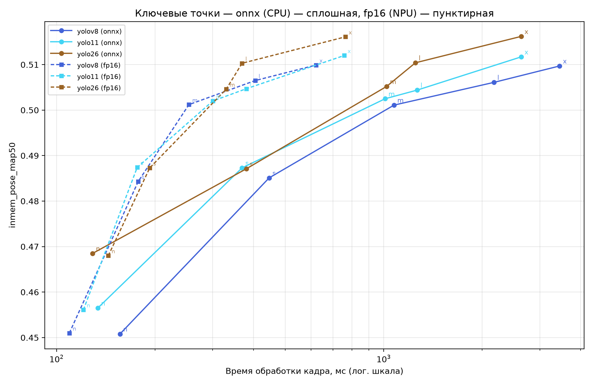

### onnx (CPU) — сплошная, fp16 (NPU) — пунктирная

| Модель | Семейство | Размер | onnx (CPU): мс | onnx (CPU): fps | onnx (CPU): метрика | fp16 (NPU): мс | fp16 (NPU): fps | fp16 (NPU): метрика |
|---|---|---|---|---|---|---|---|---|
| yolo11l-pose | yolo11 | l | 1265.8 | 0.8 | 0.5044 | 380.2 | 2.6 | 0.5047 |
| yolo11m-pose | yolo11 | m | 1010.1 | 1.0 | 0.5025 | 300.3 | 3.3 | 0.5020 |
| yolo11n-pose | yolo11 | n | 133.7 | 7.5 | 0.4565 | 120.8 | 8.3 | 0.4561 |
| yolo11s-pose | yolo11 | s | 369.0 | 2.7 | 0.4873 | 176.4 | 5.7 | 0.4874 |
| yolo11x-pose | yolo11 | x | 2631.6 | 0.4 | 0.5117 | 757.6 | 1.3 | 0.5120 |
| yolo26l-pose | yolo26 | l | 1250.0 | 0.8 | 0.5104 | 369.0 | 2.7 | 0.5103 |
| yolo26m-pose | yolo26 | m | 1020.4 | 1.0 | 0.5052 | 330.0 | 3.0 | 0.5046 |
| yolo26n-pose | yolo26 | n | 128.9 | 7.8 | 0.4685 | 143.9 | 7.0 | 0.4680 |
| yolo26s-pose | yolo26 | s | 380.2 | 2.6 | 0.4871 | 192.7 | 5.2 | 0.4873 |
| yolo26x-pose | yolo26 | x | 2631.6 | 0.4 | 0.5162 | 763.4 | 1.3 | 0.5161 |
| yolov8l-pose | yolov8 | l | 2173.9 | 0.5 | 0.5061 | 404.9 | 2.5 | 0.5065 |
| yolov8m-pose | yolov8 | m | 1075.3 | 0.9 | 0.5011 | 253.8 | 3.9 | 0.5012 |
| yolov8n-pose | yolov8 | n | 156.2 | 6.4 | 0.4508 | 109.4 | 9.1 | 0.4510 |
| yolov8s-pose | yolov8 | s | 446.4 | 2.2 | 0.4851 | 177.6 | 5.6 | 0.4843 |
| yolov8x-pose | yolov8 | x | 3448.3 | 0.3 | 0.5097 | 621.1 | 1.6 | 0.5099 |

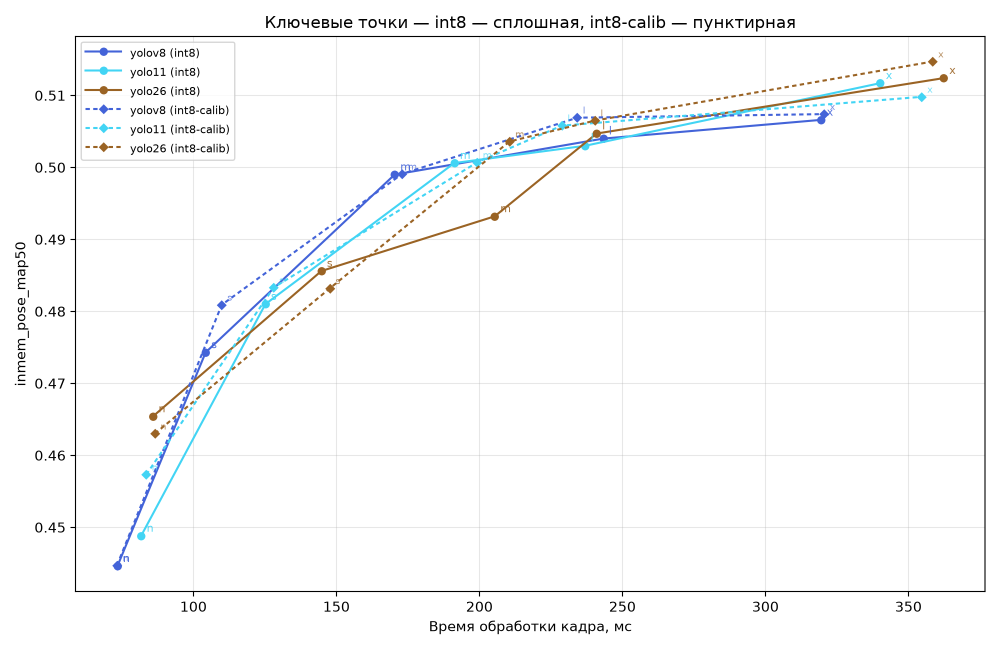

### int8 — сплошная, int8-calib — пунктирная

| Модель | Семейство | Размер | int8 (NPU): мс | int8 (NPU): fps | int8 (NPU): метрика | int8-calib (NPU): мс | int8-calib (NPU): fps | int8-calib (NPU): метрика |
|---|---|---|---|---|---|---|---|---|
| yolo11l-pose | yolo11 | l | 237.0 | 4.2 | 0.5030 | 228.8 | 4.4 | 0.5058 |
| yolo11m-pose | yolo11 | m | 191.2 | 5.2 | 0.5006 | 199.2 | 5.0 | 0.5007 |
| yolo11n-pose | yolo11 | n | 81.7 | 12.2 | 0.4488 | 83.5 | 12.0 | 0.4573 |
| yolo11s-pose | yolo11 | s | 125.2 | 8.0 | 0.4810 | 128.0 | 7.8 | 0.4833 |
| yolo11x-pose | yolo11 | x | 340.1 | 2.9 | 0.5117 | 354.6 | 2.8 | 0.5098 |
| yolo26l-pose | yolo26 | l | 241.0 | 4.2 | 0.5047 | 240.4 | 4.2 | 0.5065 |
| yolo26m-pose | yolo26 | m | 205.3 | 4.9 | 0.4932 | 210.5 | 4.8 | 0.5036 |
| yolo26n-pose | yolo26 | n | 85.8 | 11.7 | 0.4654 | 86.5 | 11.6 | 0.4630 |
| yolo26s-pose | yolo26 | s | 144.7 | 6.9 | 0.4856 | 147.7 | 6.8 | 0.4832 |
| yolo26x-pose | yolo26 | x | 362.3 | 2.8 | 0.5124 | 358.4 | 2.8 | 0.5147 |
| yolov8l-pose | yolov8 | l | 243.3 | 4.1 | 0.5040 | 234.2 | 4.3 | 0.5069 |
| yolov8m-pose | yolov8 | m | 170.4 | 5.9 | 0.4990 | 173.0 | 5.8 | 0.4991 |
| yolov8n-pose | yolov8 | n | 73.4 | 13.6 | 0.4446 | 73.3 | 13.7 | 0.4447 |
| yolov8s-pose | yolov8 | s | 104.3 | 9.6 | 0.4743 | 109.9 | 9.1 | 0.4809 |
| yolov8x-pose | yolov8 | x | 319.5 | 3.1 | 0.5066 | 320.5 | 3.1 | 0.5074 |

## Повёрнутые боксы (obb)

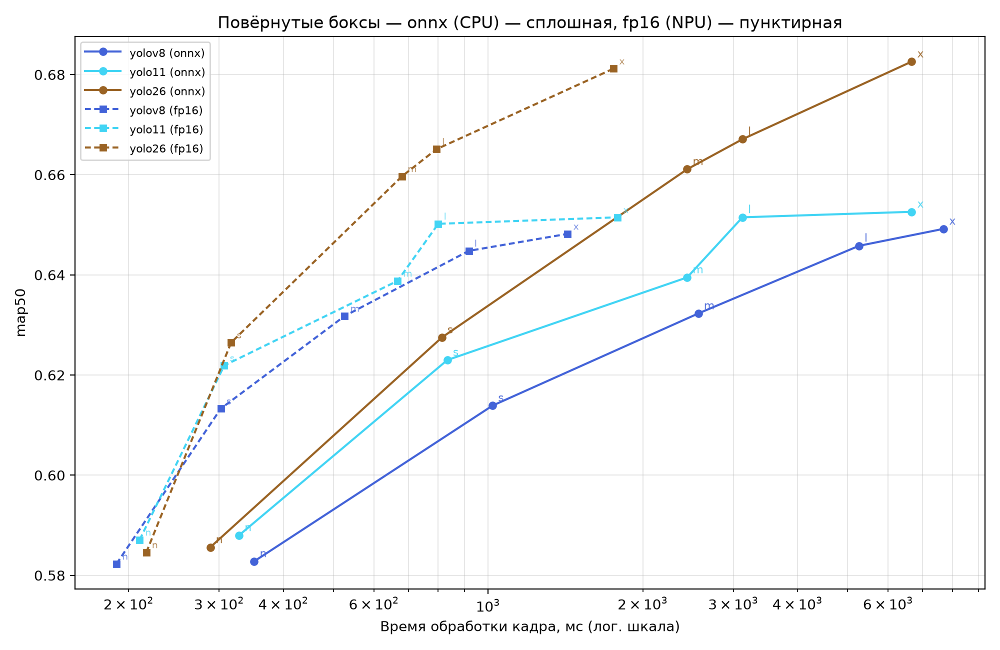

### onnx (CPU) — сплошная, fp16 (NPU) — пунктирная

| Модель | Семейство | Размер | onnx (CPU): мс | onnx (CPU): fps | onnx (CPU): метрика | fp16 (NPU): мс | fp16 (NPU): fps | fp16 (NPU): метрика |
|---|---|---|---|---|---|---|---|---|
| yolo11l-obb | yolo11 | l | 3125.0 | 0.3 | 0.6515 | 800.0 | 1.2 | 0.6502 |
| yolo11m-obb | yolo11 | m | 2439.0 | 0.4 | 0.6395 | 666.7 | 1.5 | 0.6388 |
| yolo11n-obb | yolo11 | n | 327.9 | 3.0 | 0.5880 | 210.1 | 4.8 | 0.5871 |
| yolo11s-obb | yolo11 | s | 833.3 | 1.2 | 0.6230 | 306.7 | 3.3 | 0.6219 |
| yolo11x-obb | yolo11 | x | 6666.7 | 0.1 | 0.6526 | 1785.7 | 0.6 | 0.6515 |
| yolo26l-obb | yolo26 | l | 3125.0 | 0.3 | 0.6671 | 793.7 | 1.3 | 0.6651 |
| yolo26m-obb | yolo26 | m | 2439.0 | 0.4 | 0.6611 | 680.3 | 1.5 | 0.6597 |
| yolo26n-obb | yolo26 | n | 288.2 | 3.5 | 0.5856 | 216.5 | 4.6 | 0.5846 |
| yolo26s-obb | yolo26 | s | 813.0 | 1.2 | 0.6275 | 316.5 | 3.2 | 0.6265 |
| yolo26x-obb | yolo26 | x | 6666.7 | 0.1 | 0.6826 | 1754.4 | 0.6 | 0.6812 |
| yolov8l-obb | yolov8 | l | 5263.2 | 0.2 | 0.6458 | 917.4 | 1.1 | 0.6448 |
| yolov8m-obb | yolov8 | m | 2564.1 | 0.4 | 0.6323 | 526.3 | 1.9 | 0.6318 |
| yolov8n-obb | yolov8 | n | 350.9 | 2.9 | 0.5828 | 189.4 | 5.3 | 0.5823 |
| yolov8s-obb | yolov8 | s | 1020.4 | 1.0 | 0.6139 | 302.1 | 3.3 | 0.6133 |
| yolov8x-obb | yolov8 | x | 7692.3 | 0.1 | 0.6492 | 1428.6 | 0.7 | 0.6482 |

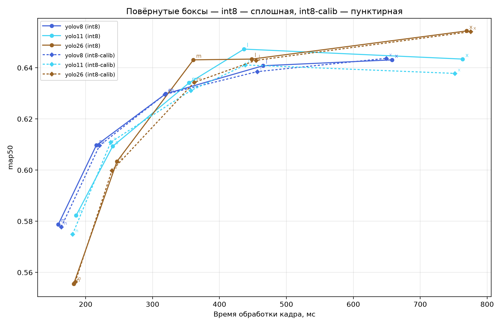

### int8 — сплошная, int8-calib — пунктирная

| Модель | Семейство | Размер | int8 (NPU): мс | int8 (NPU): fps | int8 (NPU): метрика | int8-calib (NPU): мс | int8-calib (NPU): fps | int8-calib (NPU): метрика |
|---|---|---|---|---|---|---|---|---|
| yolo11l-obb | yolo11 | l | 436.7 | 2.3 | 0.6473 | 438.6 | 2.3 | 0.6411 |
| yolo11m-obb | yolo11 | m | 354.6 | 2.8 | 0.6341 | 357.1 | 2.8 | 0.6311 |
| yolo11n-obb | yolo11 | n | 185.9 | 5.4 | 0.5823 | 180.5 | 5.5 | 0.5749 |
| yolo11s-obb | yolo11 | s | 240.4 | 4.2 | 0.6093 | 237.5 | 4.2 | 0.6109 |
| yolo11x-obb | yolo11 | x | 763.4 | 1.3 | 0.6434 | 751.9 | 1.3 | 0.6378 |
| yolo26l-obb | yolo26 | l | 448.4 | 2.2 | 0.6434 | 454.5 | 2.2 | 0.6429 |
| yolo26m-obb | yolo26 | m | 361.0 | 2.8 | 0.6431 | 362.3 | 2.8 | 0.6343 |
| yolo26n-obb | yolo26 | n | 182.1 | 5.5 | 0.5555 | 184.5 | 5.4 | 0.5563 |
| yolo26s-obb | yolo26 | s | 246.9 | 4.0 | 0.6034 | 239.2 | 4.2 | 0.5998 |
| yolo26x-obb | yolo26 | x | 769.2 | 1.3 | 0.6544 | 775.2 | 1.3 | 0.6541 |
| yolov8l-obb | yolov8 | l | 465.1 | 2.1 | 0.6408 | 456.6 | 2.2 | 0.6385 |
| yolov8m-obb | yolov8 | m | 319.5 | 3.1 | 0.6298 | 318.5 | 3.1 | 0.6296 |
| yolov8n-obb | yolov8 | n | 159.2 | 6.3 | 0.5788 | 163.7 | 6.1 | 0.5778 |
| yolov8s-obb | yolov8 | s | 216.0 | 4.6 | 0.6097 | 220.8 | 4.5 | 0.6096 |
| yolov8x-obb | yolov8 | x | 657.9 | 1.5 | 0.6431 | 649.4 | 1.5 | 0.6437 |

## Классификация (cls)

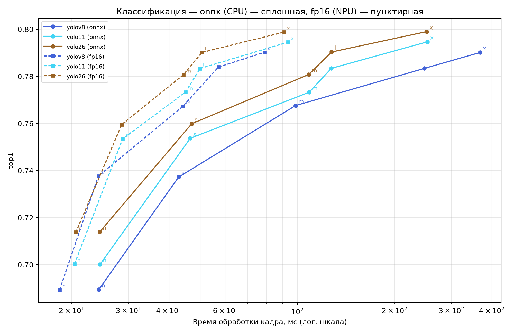

### onnx (CPU) — сплошная, fp16 (NPU) — пунктирная

| Модель | Семейство | Размер | onnx (CPU): мс | onnx (CPU): fps | onnx (CPU): метрика | fp16 (NPU): мс | fp16 (NPU): fps | fp16 (NPU): метрика |
|---|---|---|---|---|---|---|---|---|
| yolo11l-cls | yolo11 | l | 127.2 | 7.9 | 0.7834 | 49.9 | 20.0 | 0.7833 |
| yolo11m-cls | yolo11 | m | 108.7 | 9.2 | 0.7732 | 45.0 | 22.2 | 0.7733 |
| yolo11n-cls | yolo11 | n | 24.5 | 40.9 | 0.7001 | 20.4 | 49.0 | 0.7003 |
| yolo11s-cls | yolo11 | s | 46.6 | 21.5 | 0.7537 | 28.7 | 34.8 | 0.7534 |
| yolo11x-cls | yolo11 | x | 252.5 | 4.0 | 0.7947 | 93.5 | 10.7 | 0.7945 |
| yolo26l-cls | yolo26 | l | 127.6 | 7.8 | 0.7903 | 50.6 | 19.8 | 0.7902 |
| yolo26m-cls | yolo26 | m | 108.3 | 9.2 | 0.7808 | 44.3 | 22.6 | 0.7807 |
| yolo26n-cls | yolo26 | n | 24.4 | 40.9 | 0.7139 | 20.6 | 48.5 | 0.7137 |
| yolo26s-cls | yolo26 | s | 47.0 | 21.3 | 0.7599 | 28.5 | 35.0 | 0.7595 |
| yolo26x-cls | yolo26 | x | 251.3 | 4.0 | 0.7990 | 90.9 | 11.0 | 0.7988 |
| yolov8l-cls | yolov8 | l | 246.9 | 4.0 | 0.7834 | 56.9 | 17.6 | 0.7839 |
| yolov8m-cls | yolov8 | m | 98.6 | 10.1 | 0.7676 | 44.2 | 22.6 | 0.7673 |
| yolov8n-cls | yolov8 | n | 24.2 | 41.3 | 0.6894 | 18.3 | 54.5 | 0.6893 |
| yolov8s-cls | yolov8 | s | 42.8 | 23.3 | 0.7372 | 24.2 | 41.4 | 0.7376 |
| yolov8x-cls | yolov8 | x | 367.6 | 2.7 | 0.7901 | 79.0 | 12.7 | 0.7902 |

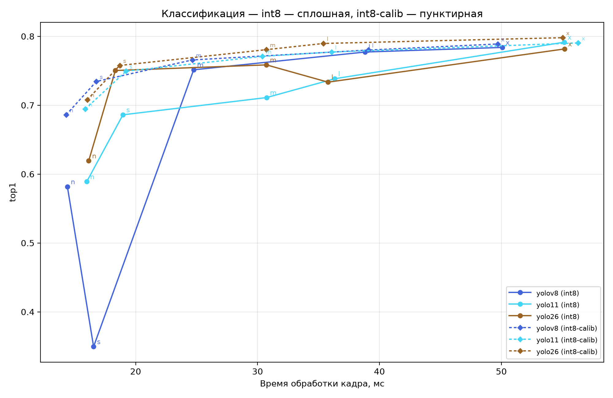

### int8 — сплошная, int8-calib — пунктирная

| Модель | Семейство | Размер | int8 (NPU): мс | int8 (NPU): fps | int8 (NPU): метрика | int8-calib (NPU): мс | int8-calib (NPU): fps | int8-calib (NPU): метрика |
|---|---|---|---|---|---|---|---|---|
| yolo11l-cls | yolo11 | l | 36.3 | 27.5 | 0.7384 | 36.1 | 27.7 | 0.7772 |
| yolo11m-cls | yolo11 | m | 30.7 | 32.5 | 0.7110 | 30.4 | 32.9 | 0.7709 |
| yolo11n-cls | yolo11 | n | 16.0 | 62.5 | 0.5889 | 15.9 | 63.0 | 0.6944 |
| yolo11s-cls | yolo11 | s | 19.0 | 52.8 | 0.6860 | 19.2 | 52.0 | 0.7494 |
| yolo11x-cls | yolo11 | x | 55.2 | 18.1 | 0.7914 | 56.3 | 17.8 | 0.7904 |
| yolo26l-cls | yolo26 | l | 35.8 | 27.9 | 0.7334 | 35.4 | 28.2 | 0.7896 |
| yolo26m-cls | yolo26 | m | 30.7 | 32.5 | 0.7585 | 30.7 | 32.5 | 0.7806 |
| yolo26n-cls | yolo26 | n | 16.1 | 61.9 | 0.6192 | 16.0 | 62.4 | 0.7079 |
| yolo26s-cls | yolo26 | s | 18.3 | 54.5 | 0.7503 | 18.7 | 53.5 | 0.7577 |
| yolo26x-cls | yolo26 | x | 55.2 | 18.1 | 0.7817 | 55.0 | 18.2 | 0.7980 |
| yolov8l-cls | yolov8 | l | 38.8 | 25.8 | 0.7772 | 39.1 | 25.6 | 0.7801 |
| yolov8m-cls | yolov8 | m | 24.8 | 40.4 | 0.7513 | 24.7 | 40.6 | 0.7657 |
| yolov8n-cls | yolov8 | n | 14.4 | 69.4 | 0.5816 | 14.3 | 69.9 | 0.6861 |
| yolov8s-cls | yolov8 | s | 16.6 | 60.4 | 0.3494 | 16.8 | 59.6 | 0.7345 |
| yolov8x-cls | yolov8 | x | 50.1 | 20.0 | 0.7839 | 49.7 | 20.1 | 0.7888 |

## Семантическая сегментация (sem)

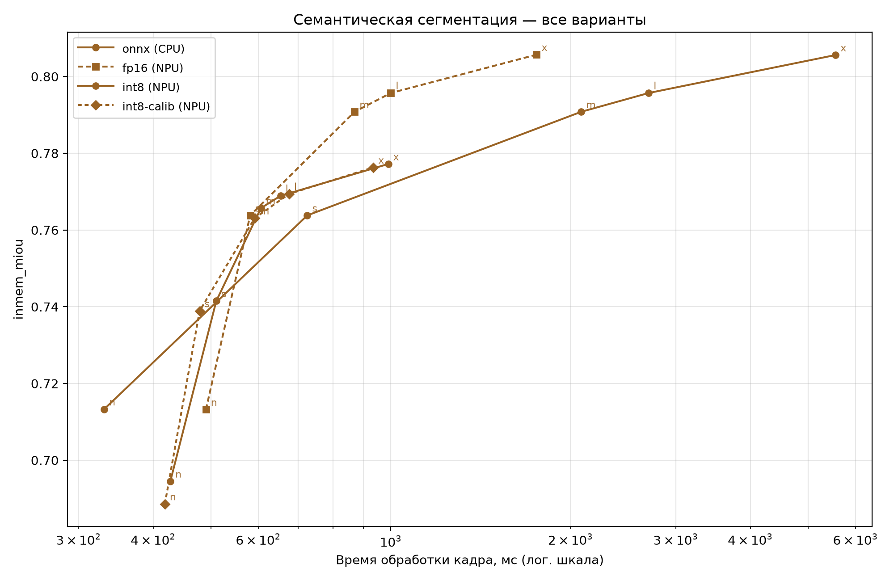

**onnx (CPU):**

| Модель | Размер | Время кадра, мс | fps | метрика |
|---|---|---|---|---|
| yolo26n-sem | n | 331.1 | 3.0 | 0.7133 |
| yolo26s-sem | s | 724.6 | 1.4 | 0.7638 |
| yolo26m-sem | m | 2083.3 | 0.5 | 0.7908 |
| yolo26l-sem | l | 2702.7 | 0.4 | 0.7957 |
| yolo26x-sem | x | 5555.6 | 0.2 | 0.8056 |

**fp16 (NPU):**

| Модель | Размер | Время кадра, мс | fps | метрика |
|---|---|---|---|---|
| yolo26n-sem | n | 490.2 | 2.0 | 0.7132 |
| yolo26s-sem | s | 581.4 | 1.7 | 0.7638 |
| yolo26m-sem | m | 869.6 | 1.1 | 0.7908 |
| yolo26l-sem | l | 1000.0 | 1.0 | 0.7957 |
| yolo26x-sem | x | 1754.4 | 0.6 | 0.8057 |

**int8 (NPU):**

| Модель | Размер | Время кадра, мс | fps | метрика |
|---|---|---|---|---|
| yolo26n-sem | n | 427.4 | 2.3 | 0.6945 |
| yolo26s-sem | s | 510.2 | 2.0 | 0.7415 |
| yolo26m-sem | m | 606.1 | 1.6 | 0.7657 |
| yolo26l-sem | l | 653.6 | 1.5 | 0.7689 |
| yolo26x-sem | x | 990.1 | 1.0 | 0.7772 |

**int8-calib (NPU):**

| Модель | Размер | Время кадра, мс | fps | метрика |
|---|---|---|---|---|
| yolo26n-sem | n | 418.4 | 2.4 | 0.6886 |
| yolo26s-sem | s | 478.5 | 2.1 | 0.7389 |
| yolo26m-sem | m | 591.7 | 1.7 | 0.7631 |
| yolo26l-sem | l | 675.7 | 1.5 | 0.7694 |
| yolo26x-sem | x | 934.6 | 1.1 | 0.7763 |

